# Simmy Parmar

<picture>
  <source media="(prefers-color-scheme: dark)" srcset="./dark.svg">
  <source media="(prefers-color-scheme: light)" srcset="./light.svg">
  
</picture>

## About

I’m a **B.Tech CSE (AI) Student** at **Mandsaur University**, currently exploring software development, AI/ML, and practical web technologies.

## Focus

- Python and programming fundamentals
- Web development
- AI / ML exploration
- Building practical projects
- Continuous learning and problem solving

## Tech Stack

**Languages:** C · Python · JavaScript · SQL  
**Web:** HTML · CSS · JavaScript · React  
**Tools & Design:** Canva · CapCut  
**Interests:** AI/ML · Web Development · Software Projects

## Featured Projects

### Glowar
Virtual try-on browser extension using web-based AR and face-tracking concepts.

### AI Speech Recognition Platform
AI-powered platform focused on speech recognition and speech-based interaction.

### InternEase
Internship finder platform developed as a project-based learning project.

## Education

**B.Tech CSE (AI)**  
Mandsaur University · Semester III

## Connect

- [GitHub](https://github.com/moonlitecode)
- [LinkedIn](https://www.linkedin.com/in/simmy-parmar-8232a4320/)
- [Canva](https://www.canva.com/)
- Email: [simmyparmar312@gmail.com](mailto:simmyparmar312@gmail.com)

---

> Built with a terminal-inspired, theme-aware SVG profile system.
